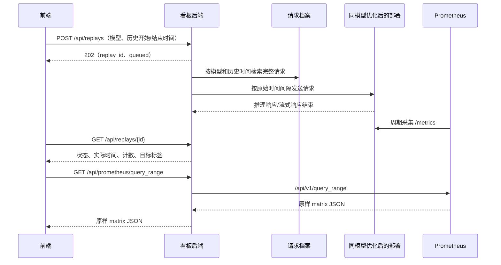

# TrafficReplay 流量回放接口对接文档

本文依据当前前端 `src/App.tsx`、`src/data.ts` 和 `src/types.ts` 编写。两个回放接口是前端已预留、需要看板后端实现的契约；文档不表示它们已在真实后端上线。本文只补充文档，不修改前端接口或回放逻辑。

## 1. 功能与接口范围

用户选择一个模型，在历史处理/等待曲线中拖选区间，再确认回放。前端只提交模型、历史开始时间、历史结束时间。后端查询完整请求档案，按照原始请求间隔，将这段流量重新发送给该模型当前优化后的部署。

创建任务采用异步方式：接口返回任务 ID，后台继续检索、调度和发送请求。前端通过状态接口获取实际打流时间，再使用已有 Prometheus 接口查询回放后的曲线。

| 接口 | 方法 | 用途 | 对接范围 |
| --- | --- | --- | --- |
| `/api/replays` | POST | 创建回放任务，返回任务 ID | 后端需要实现 |
| `/api/replays/{id}` | GET | 查询状态、计数、实际开始/结束时间、目标指标标签 | 后端需要实现 |
| `/api/prometheus/query_range` | GET | 查询历史及回放后的处理/等待曲线 | 使用已有接口 |
| `/api/prometheus/query` | GET | 模型发现及五项即时延迟查询 | 使用已有接口 |

当前前端没有取消任务、任务列表、重新加载页面后恢复任务的接口调用。状态中支持 `cancelled`，但页面没有取消按钮。



## 2. 公共约定

### 2.1 地址与时间

- 看板后端：`http://<DASHBOARD_BACKEND_IP>:<DASHBOARD_BACKEND_PORT>`。
- LiteLLM：`http://<LITELLM_IP>:<LITELLM_PORT>`；vLLM：`http://<VLLM_IP>:<VLLM_PORT>`。这些打流地址和服务凭据由后端维护。
- Prometheus：`http://<PROMETHEUS_IP>:<PROMETHEUS_PORT>`，由已有看板后端代理。
- 浏览器请求同源 `/api/...`；本地由 Vite 代理，生产由静态服务反向代理。
- 所有接口时间字段为 JSON number，单位为 Unix **秒**。本次契约使用整数秒，不传 JavaScript 毫秒，也不传日期文本。
- 回放档案过滤区间为 `[start_time, end_time)`：包含开始，不包含结束。后端可保留档案原始时间的毫秒精度来调度请求，不必将请求时间取整。
- 页面按 `Asia/Shanghai` 展示和解释输入；时间戳本身无时区歧义。

示例时间：`1791770400` 对应上海时间 `2026-10-12 10:00:00`；`1791771000` 对应 `2026-10-12 10:10:00`。

### 2.2 请求头与认证

创建接口发送：

```http
Content-Type: application/json
Idempotency-Key: <UUID>
```

若在页面“连接设置”输入了认证值，POST 和状态 GET 会携带所选的一种认证头：

```http
Authorization: Bearer <TOKEN>
```

或 `x-api-key: <KEY>`，或 `x-litellm-key: <KEY>`。页面只发送选中的一种；没有填写认证值则不发送。后端按自己的认证规则校验，并建立到 LiteLLM/vLLM 的调用权限。

Prometheus 查询不携带这些认证头。`Idempotency-Key` 只随创建 POST 发送。

回放成功响应为直接 JSON 对象，不能包装成 `{ "data": { ... } }`。任务状态接口建议返回 `Cache-Control: no-store`，不要套用 Prometheus 的 30 秒查询缓存。前端单次 HTTP 请求超时为 **20 秒**。

## 3. 创建回放任务

### 3.1 请求

```http
POST /api/replays
```

```json
{
  "model_id": "DeepSeek-R1",
  "start_time": 1791770400,
  "end_time": 1791771000
}
```

| 字段 | 类型 | 必填 | 含义 |
| --- | --- | --- | --- |
| `model_id` | string | 是 | 所选逻辑模型；默认就是下拉框中的 Prometheus `model_name`，配置映射时为回放别名 |
| `start_time` | number | 是 | 历史区间开始，Unix 整数秒 |
| `end_time` | number | 是 | 历史区间结束，Unix 整数秒，必须大于开始 |

当前前端只发送这三个字段，不发送目标 IP、部署实例、回放速度或完整请求内容。默认语义为“同模型当前部署、原速回放”。后端必须将逻辑模型解析为优化后的目标路由，并在任务创建时保存目标快照，避免任务运行期间配置变化导致打流目标漂移。

### 3.2 响应

推荐返回 `202 Accepted`，表示任务已受理，执行尚未完成。当前前端也能解析其他正常的 2xx JSON 响应。

```json
{
  "replay_id": "replay-20261012-0001",
  "status": "queued",
  "target": {
    "metrics_labels": {
      "model_name": "DeepSeek-R1",
      "deployment": "deepseek-optimized"
    }
  }
}
```

| 字段 | 类型 | 对接要求 | 含义 |
| --- | --- | --- | --- |
| `replay_id` | string | 必须返回非空任务 ID | 后续状态 GET 的路径参数；不能改名为 `id` 或 `task_id` |
| `status` | string | 应返回 | 使用第 5 节中的固定英文状态；通常是 `queued` 或 `preparing` |
| `started_at` | number | 实际发送开始后才返回 | 第一个回放请求实际发出的时间，Unix 秒 |
| `request_count` | number | 数量确定后返回 | 本任务实际纳入回放的总请求数；尚未确定时省略 |
| `target.metrics_labels` | object | 可选，推荐返回 | Prometheus 中定位优化后目标部署的标签，值均为字符串 |

任务没有开始时省略 `started_at`，不要填写按钮点击时间或预计开始时间。不要为未知总请求数填写 `0`；`0` 表示确实没有请求。

### 3.3 幂等语义

前端在相同模型与时间条件的创建失败后重试时复用 `Idempotency-Key`。创建成功后再次进行回放会生成新键。

后端需要实现以下行为，不能仅接收请求头后忽略它：

| 情况 | 后端行为 |
| --- | --- |
| 相同调用方、相同键、相同请求体 | 返回原任务 ID；不能再创建任务或再打一次流 |
| 相同调用方、相同键、不同请求体 | 返回 `409 Conflict` |
| 不同键、相同请求体 | 可以作为新的实验创建任务，受后端并发策略约束 |

幂等记录、任务创建和调度入队要避免并发重复；可采用数据库唯一约束和事务/可靠队列。幂等记录应覆盖客户端重试期及任务运行期，不能沿用 30 秒指标缓存 TTL。

如果 POST 在浏览器 20 秒超时前没有返回，但后端已经创建了任务，下一次同键请求必须仍返回这个任务。创建接口应尽快返回，不应等待数分钟/数小时的回放全部结束。

## 4. 查询任务状态

### 4.1 请求

```http
GET /api/replays/replay-20261012-0001
```

`{id}` 为创建响应的 `replay_id`；前端插入路径前会进行 URL 编码。没有请求体，不需要传历史时间或再次传模型。

### 4.2 运行中响应

```json
{
  "replay_id": "replay-20261012-0001",
  "status": "running",
  "started_at": 1791774000,
  "request_count": 1200,
  "sent_count": 600,
  "completed_count": 560,
  "target": {
    "metrics_labels": {
      "model_name": "DeepSeek-R1",
      "deployment": "deepseek-optimized"
    }
  }
}
```

### 4.3 完成响应

```json
{
  "replay_id": "replay-20261012-0001",
  "status": "succeeded",
  "started_at": 1791774000,
  "finished_at": 1791774620,
  "request_count": 1200,
  "sent_count": 1200,
  "completed_count": 1200,
  "target": {
    "metrics_labels": {
      "model_name": "DeepSeek-R1",
      "deployment": "deepseek-optimized"
    }
  }
}
```

| 字段 | 类型 | 对接要求 | 含义 |
| --- | --- | --- | --- |
| `status` | string | 每次必填 | 当前状态；未知状态会触发前端错误 |
| `replay_id` | string | 建议返回 | 便于联调；当前前端使用请求路径中的 ID |
| `started_at` | number | 开始后每次返回 | 必须保持实际开始时间一致，不能在后续响应中省略 |
| `finished_at` | number | 终态且工作已结束时返回 | 成功时为最后一个请求响应处理完毕的时间；失败/取消时为任务实际停止且在途请求已结束或被终止的时间 |
| `request_count` | number | 确定后每次返回 | 纳入回放的总数 |
| `sent_count` | number | 开始计数后每次返回 | 已发出的唯一原始请求数；内部重试次数不重复累计 |
| `completed_count` | number | 开始计数后每次返回 | 已结束处理的请求数，建议包含已取得最终结果的成功、错误或超时请求 |
| `target.metrics_labels` | object | 与创建响应保持一致 | 定位目标部署；建议每次返回 |

正常计数应满足 `0 <= completed_count <= sent_count <= request_count`，且已确定的计数不倒退。内部重试等额外诊断计数可另加字段，不要改变上述计数的语义。建议全部成功才使用 `succeeded`；部分失败时如何判定任务结果需要后端确定并保持一致。

当前前端每次状态响应直接更新 `started_at`、`finished_at` 和三个计数，不支持仅返回变化字段的增量响应。`sent_count` 会被保存，但当前页面只显示“已完成 / 总请求”。时间/计数未知时应省略字段，不发送 `null` 或表示“未知”的 `0`；字段一旦已知，后续响应应继续返回。

可补充 `error`、`failed_count` 等诊断字段，但当前前端尚未展示成功 HTTP 响应中的业务失败详情。返回 `200` 和 `status: "failed"` 会显示任务失败；如需同时展示具体失败原因，需要另外补前端字段解析与 UI。不要用 HTTP `500` 代替可正常读取的任务失败状态。

## 5. 状态和执行规则

| 状态 | 页面文字 | 后端含义 |
| --- | --- | --- |
| `queued` | 等待开始 | 已入队，等待执行 |
| `preparing` | 准备请求 | 检索档案、核对路由、准备调度 |
| `running` | 回放中 | 已开始发流，仍有请求尚未发送 |
| `draining` | 等待处理完成 | 请求发送完毕，等待在途推理/流式响应结束 |
| `succeeded` | 已完成 | 任务成功结束 |
| `failed` | 失败 | 任务执行失败，执行工作已终止 |
| `cancelled` | 已取消 | 任务被取消，执行工作已终止 |

典型过程为 `queued → preparing → running → draining → succeeded`；失败和取消可从非终态进入。终态不能再退回运行状态。

后端以档案中的原始请求到达时间计算调度偏移。例如历史区间 `[10:00:00, 10:10:00)` 内两个请求分别在 `10:00:05`、`10:00:08` 到达，应保留 3 秒间隔。建议以首个纳入回放的请求为调度零点：若首个请求实际于 `11:00:00` 发出，第二个应计划于 `11:00:03` 发出，`started_at` 就是 `11:00:00`。

这会省略选区起点到首个请求之间的空闲时间；当前前端没有“保留起始空闲”开关。请求间的内部空闲间隔应保留，发送采用并发调度，不能等待前一个推理完成后再发送下一个请求。若限速/并发上限导致无法维持原始节奏，应记录该偏差供实验解释。

历史流量和当前路由均以同一个逻辑模型匹配。模型改名后，后端需维护历史档案名称与当前服务名称的对应关系。Prometheus 保存的是指标，不含完整推理请求；回放必须依赖已有请求档案中的请求时间、请求体、路由所需信息，以及原请求使用的流式/非流式等配置。调用凭据由后端选取当前有效配置。

对于流式请求，应等到响应流结束或明确失败才计入 `completed_count`。全部请求发出只能进入 `draining`，不能立即标为完成。后端可以自行设置超时规则，当前前端不会按 45 秒或历史区间长度判定生产任务完成。

## 6. 模型名称与目标指标标签

当前下拉框来自 Prometheus：

```promql
count by (model_name) (vllm:num_requests_running)
```

默认 `model_id` 等于发现的 `model_name`。若 LiteLLM/档案使用逻辑别名，可在 `.env.local` 配置：

```dotenv
VITE_MODEL_METRICS_MAP='{"deepseek-service":"DeepSeek-R1"}'
```

下拉框和历史指标使用 `DeepSeek-R1`；创建请求提交 `model_id: "deepseek-service"`。后端将该别名同时关联到历史档案和当前优化部署。

若优化后的 Prometheus 模型名变为 `DeepSeek-R1-v2`，后端可以返回：

```json
{
  "target": {
    "metrics_labels": {
      "model_name": "DeepSeek-R1-v2",
      "deployment": "deepseek-optimized"
    }
  }
}
```

回放右侧查询优先使用这里的 `model_name`，因此当前前端支持优化部署的指标名称变化。其他标签会追加为等值匹配条件。标签必须真实存在于两项 vLLM 指标中；随意增加 `replay_id`、部署标签或不存在的标签会导致空结果。

不返回标签时，前端使用创建任务时保存的指标模型名，汇总该模型所有匹配序列。若同一模型同时有多个部署，推荐返回能覆盖整套目标部署的标签。DeepSeek PD 部署不应只过滤单一 `role` 或 `engine`，否则只显示一个阶段/分片；应使用可覆盖 proxy/prefill/decode 的共同部署标签。

## 7. 前端如何获取回放曲线

当前前端立即发起一次状态查询，此后后端模式每 **30 秒**查询一轮。尚无 `started_at` 时只显示等待打流开始，不查询回放曲线。

收到实际开始时间后，以它作为固定起点，查询已有 `/api/prometheus/query_range`：

```promql
sum by (model_name) (
  vllm:num_requests_running{
    model_name="DeepSeek-R1",
    deployment="deepseek-optimized"
  }
)
```

```promql
sum by (model_name) (
  vllm:num_requests_waiting{
    model_name="DeepSeek-R1",
    deployment="deepseek-optimized"
  }
)
```

对应请求参数：

```text
start = started_at
end   = 有 finished_at 时：finished_at + 30
        没有 finished_at 时：max(started_at + 30, 当前 Unix 秒)
step  = max(5, ceil((end - start) / 60))
```

两项 gauge 按所有匹配的 role/engine 求和，各展示一条曲线。开始后最少先显示 30 秒窗口；查询结束点可能短暂在未来，真实 Prometheus 的未来区间没有真实样本，前端不会把它变成模拟数据。

后端返回原样 Prometheus matrix，不要将任务响应包装成 Prometheus 格式，也不需要新增“回放曲线接口”。相对时间勾选框只把横轴转换为 `timestamp - started_at`，不修改接口时间参数。

如果后端缓存 `query_range`，缓存键必须包含 `query`、`start`、`end`、`step`。仅以 PromQL 为键会混淆同模型的历史窗口和回放窗口。当前前端自身按完整 URL 去重并缓存 30 秒。

当前前端在有 `finished_at`、当前时间超过 `finished_at + 60`，且当轮两条指标查询没有错误时，停止该任务的状态/曲线轮询。这个条件只预留采集与缓存余量，不验证数据完整；空结果也可能满足停止条件。后端不能省略终态的 `finished_at`，否则页面仍会持续轮询。若实际采集/入库延迟超过该余量，需要另外调整前端策略。

当前另有一个需要在联调中处理的边界：任务在首个请求发送前就失败/取消时，没有 `started_at`，前端会跳过曲线查询，也不会进入上述停止条件，仍继续状态轮询。后端应如实省略开始时间；若要彻底停止这种终态的轮询，需要补前端判断，不能伪造开始时间来绕过。

其他现有监测继续工作：延迟卡仍按左侧当前查询模型，通过五条即时 PromQL 获取；其回溯窗口跟随历史范围。它们没有自动限定到 `replay_id`、目标部署标签或任务实际区间，不能直接当作本次回放独立的优化前后延迟报告。右侧曲线若来自共享部署，也可能包含其他业务流量；只返回部署标签无法区分同部署中的回放流量。

## 8. 错误响应

沿用已有后端格式；`details` 最多 200 字符：

```json
{
  "error": "Invalid replay time range",
  "details": "end_time must be greater than start_time"
}
```

以下为建议后端采用的状态码；真实服务若已有约定，应在联调时对齐：

| HTTP 状态 | 用途 |
| --- | --- |
| 400 | 缺字段、类型错误、非法时间、结束不晚于开始 |
| 401 / 403 | 未认证或无该模型/任务的访问权限 |
| 404 | 模型或任务不存在；需区别于接口路径不存在 |
| 409 | 幂等键冲突，或触发后端设定的活动任务冲突策略 |
| 422 | 档案已过期、超出回放范围或确实没有可回放请求 |
| 429 | 超出请求/任务限流；当前前端收到后对 `/api` 请求退避 60 秒 |
| 503 | 当前没有可用的目标路由或执行服务 |
| 504 | 接口依赖服务超时；已受理任务后执行超时应通过任务状态返回 |
| 500 | 接口自身无法正常处理 |

业务任务失败仍允许状态接口返回 `200` 和 `status: "failed"`。HTTP 错误表示此次接口访问失败，与任务的执行状态是两件事。当前前端尚未依据 `Retry-After` 动态调整退避时间。

## 9. 后端实现步骤

1. 校验三个请求字段、调用权限、可回放范围和幂等键。
2. 解析逻辑模型到历史档案筛选条件、当前优化部署路由及目标指标标签，固定到任务记录。
3. 持久化任务与幂等关系，可靠入队，尽快返回 `202` 和任务 ID。
4. 后台按档案原始请求时间检索 `[start_time, end_time)` 中的请求，确定 `request_count`。
5. 并发调度，保留原始请求之间的到达间隔；首个请求发出时记录 `started_at`。
6. 发送完毕转为 `draining`，收集响应结束/错误/超时结果并持续更新计数。
7. 工作结束后记录终态和 `finished_at`；GET 始终返回任务的完整已知状态。

前端一次只允许一个活动任务；这不等于后端已限制所有浏览器、用户或部署的任务并发，后端仍需按实验资源容量确定自己的并发策略。

## 10. 前端配置与联调

`.env.local`：

```dotenv
BACKEND_URL=http://<DASHBOARD_BACKEND_IP>:<DASHBOARD_BACKEND_PORT>
VITE_PROMETHEUS_API_PREFIX=/api/prometheus
VITE_REPLAY_CREATE_PATH=/api/replays
VITE_REPLAY_STATUS_PATH=/api/replays/{id}
VITE_MODEL_METRICS_MAP='{}'
```

修改配置后重新运行 `npm run dev`，它会重新构建并启动预览。静态生产部署需要重新构建，并让 Web 服务将完整 `/api` 路径转发到看板后端。使用同源代理无需浏览器跨域；若另行采用跨域部署，后端需允许前端 Origin、GET/POST/OPTIONS，以及 `Content-Type`、`Idempotency-Key` 和所用认证头。

联调顺序：

1. 在页面切换“后端”，确认模型、历史曲线正常。
2. 选取有请求档案的历史区间，确认创建 POST 只含三个字段，响应为直接 JSON 且包含 `replay_id`。
3. 验证状态从排队/准备进入运行，首个真实请求发送后才出现 `started_at`；核对模型确实为当前优化部署。
4. 检查右侧两个 `query_range` 请求的起点为实际打流时间，而非历史 `start_time`，且目标标签能返回数据。
5. 验证全部发出后不会提前完成；在途请求结束后才返回终态与 `finished_at`。
6. 使用同键相同请求重复调用 POST，确认返回同一任务且没有重复发流。
7. 验证失败响应、空档案、认证失败、模型别名映射、终态后停止轮询，以及切换左侧模型不会改变正在观测任务。

目前仓库的浏览器联调脚本使用模拟 HTTP 响应；真实后端、档案检索和原速打流仍需按上述步骤验证。
